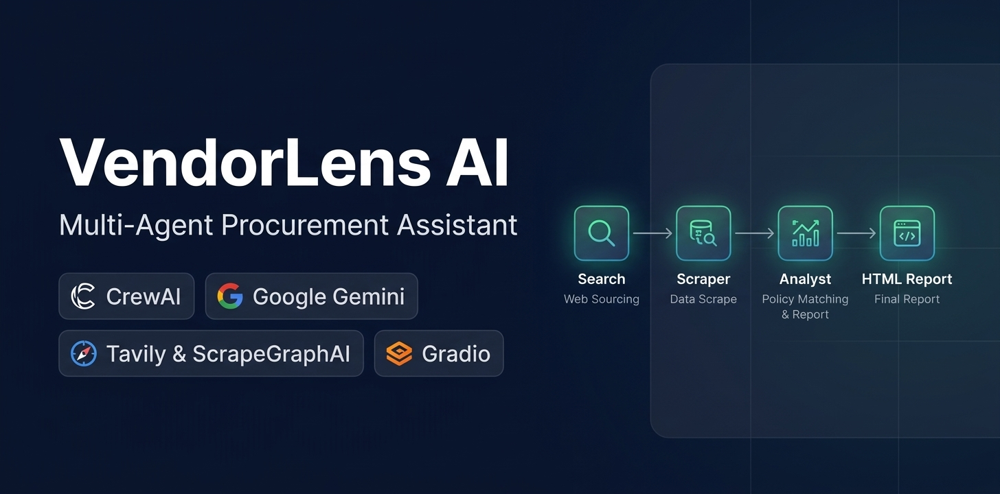

<div align="center">
  

  # 🔍 VendorLens AI — Multi-Agent Procurement Assistant

  **Autonomous Web Sourcing, Spec Extraction, Policy Matching & Executive HTML Reporting**

  [](https://python.org)
  [](https://crewai.com)
  [](https://google.dev)
  [](https://gradio.app)
  [](https://google.com)
</div>

---

## 📖 Overview

**VendorLens AI** is an end-to-end multi-agent procurement assistant built with **CrewAI** and **Google Gemini**. Given a target product and company purchasing rules (budget caps, mandatory hardware/technical specs, warranty terms, and vendor policies), a sequential team of four specialized AI agents searches the web, scrapes live product pages, evaluates compliance, scores value-for-money, and generates a downloadable, executive-ready HTML5 procurement report.

---

## ✨ Key Features

- **4-Agent Sequential Pipeline**: Divides sourcing, scraping, compliance auditing, and UI report design across specialized CrewAI agents.
- **Dual Context Chunking Strategies**: Processes company procurement policies using either **Semantic Chunking** (via local `all-MiniLM-L6-v2` embeddings) or **Recursive Character Chunking** so agents evaluate every rule accurately.
- **Zero-Cost Automatic Fallbacks**:
  - **Search**: Uses **Tavily Search API** by default and seamlessly falls back to **DuckDuckGo Search** if no Tavily key is provided.
  - **Scraping**: Uses **ScrapeGraphAI** by default and automatically falls back to **BeautifulSoup + Recursive Chunking + Gemini** extraction.
- **Executive HTML5 Reporting**: Outputs a standalone, styled HTML report (`VendorLens_Procurement_Report.html`) complete with comparison tables, compliance badges, pros/cons cards, and clickable vendor links.
- **Interactive Gradio Web UI**: Includes live report previewing in an isolated `<iframe>`, agent reasoning logs, chunk inspection tabs, and one-click report downloads.

---

## 🏗️ Multi-Agent Architecture

```text
[User Request + Company Rules]
              │
              ▼
┌───────────────────────────────┐
│   Context Chunking Module     │  ──► Semantic (MiniLM-L6-v2) or Recursive Splitter
└───────────────────────────────┘
              │
              ▼
┌───────────────────────────────┐
│ 1. Procurement Search Agent   │  ──► Tavily API (Auto-Fallback: DuckDuckGo)
└───────────────────────────────┘
              │ (3–5 Candidate URLs)
              ▼
┌───────────────────────────────┐
│ 2. Web Data Scraper Agent     │  ──► ScrapeGraphAI (Auto-Fallback: BS4 + Gemini)
└───────────────────────────────┘
              │ (Structured Specs, Prices & Warranty)
              ▼
┌───────────────────────────────┐
│ 3. Senior Procurement Analyst │  ──► Policy Compliance Check & Value Score (0–10)
└───────────────────────────────┘
              │ (Ranked Evaluation & Trade-offs)
              ▼
┌───────────────────────────────┐
│ 4. HTML Report Designer Agent │  ──► Standalone VendorLens_Procurement_Report.html
└───────────────────────────────┘
```

---

## 🛠️ Tech Stack

- **Agent Framework**: `crewai`, `crewai-tools`
- **LLM & Embeddings**: `gemini/gemini-3.8-flash` (via LiteLLM & `google-genai`), `sentence-transformers` (`all-MiniLM-L6-v2`)
- **Chunking & Text Processing**: `langchain-text-splitters`, `langchain-experimental`, `langchain-huggingface`
- **Search & Web Scraping**: `tavily-python`, `duckduckgo-search`, `scrapegraphai`, `beautifulsoup4`, `requests`
- **Frontend Interface**: `gradio`

---

## 🚀 Quickstart

### 1. Run in Google Colab (Recommended)
1. Open `VendorLens AI.ipynb` in **Google Colab**.
2. Open the **Secrets** panel (🔑 icon in the left sidebar) and add your API keys:
   - `GEMINI_API_KEY` *(Required)*
   - `TAVILY_API_KEY` *(Optional — falls back to DuckDuckGo if omitted)*
   - `SCRAPEGRAPH_API_KEY` *(Optional — falls back to BeautifulSoup + Gemini if omitted)*
3. Click **Runtime → Run all**.
4. Open the generated public Gradio link (`*.gradio.live`) to launch the web interface.

### 2. Run Locally
```bash
# Clone the repository
git clone https://github.com
cd vendorlens-ai

# Install dependencies
pip install crewai crewai-tools langchain-google-genai tavily-python scrapegraphai \
            duckduckgo-search beautifulsoup4 requests langchain-text-splitters \
            langchain-experimental sentence-transformers langchain-huggingface \
            gradio "pillow<13.0" google-genai

# Export API keys
export GEMINI_API_KEY="your_gemini_api_key"
export TAVILY_API_KEY="your_tavily_api_key"           # Optional
export SCRAPEGRAPH_API_KEY="your_scrapegraph_api_key" # Optional
```

---

## 💡 Example Usage

1. **Product Name & Technical Needs**:
   ```text
   Business Laptop 32GB RAM 1TB SSD Intel Core Ultra 7
   ```
2. **Company Context & Procurement Rules**:
   ```text
   Company: TechNova Solutions.
   Budget Limit: Maximum $1,600 per unit.
   Mandatory Specs: Minimum 32GB RAM, 1TB NVMe SSD, lightweight under 1.8kg.
   Warranty & Vendor Policy: Must include at least 1-year official warranty from reputable retailers. Avoid refurbished units.
   ```
3. **Chunking Strategy**: Select `Semantic Chunking` or `Recursive Chunking` and click **🚀 Run Multi-Agent Procurement Crew**.
4. Inspect the live report in the **📄 Live HTML Report Preview** tab or click **📥 Download Final HTML Procurement Report** to export `VendorLens_Procurement_Report.html`.

---

## 📁 Repository Structure

```text
├── VendorLens AI.ipynb                 # Main Google Colab notebook with full pipeline & Gradio UI
├── banner.png                          # Project header banner
├── VendorLens_Procurement_Report.html  # Sample generated HTML5 executive report
└── README.md                           # Project documentation
```

---

## 📄 License

This project is open-source and available under the [MIT License](LICENSE).
